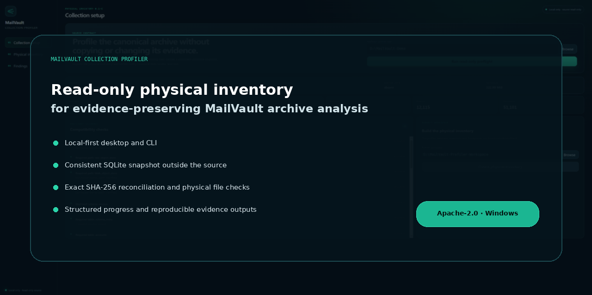

<div dir="rtl" align="right">

<p align="center"></p>

# MailVault Collection Profiler

**پروفایل فنی محلی، فقط‌خواندنی، پیوسته و قابل Resume برای آرشیوهای MailVault.**

[English](README.md) · [دریافت](https://github.com/FireXCore/mailvault-collection-profiler/releases) · [شروع سریع](docs/GETTING_STARTED.md) · [امنیت](SECURITY.md)

> `0.1.0-alpha.6` آخرین نسخه Feature است. این نسخه Profile اولیه، ادامه Incremental، Resume همان Run
> پس از قطع، Retry فایل‌های ناموفق و تشخیص خودکار فرمت با Siegfried `1.11.6` و PRONOM `v124` را
> در یک Pipeline واحد ادغام می‌کند. بعد از این Release فقط Maintenance، Security و Compatibility مجاز است.

## Pipeline نهایی

```text
MailVault فقط‌خواندنی
  → Snapshot سازگار با SQLite Online Backup
  → Reconciliation کامل metadata
  → Projection تجمعی بر پایه SHA-256
  → File-stat انتخابی و Retry خطاها
  → Exact-format خودکار و PUID
  → Generation موفق + Retention محدود Snapshot
```

اجرای بعدی روی همان Workspace، Metadata Snapshot جدید را کامل مقایسه می‌کند اما File-stat و Format
موفق و بدون تغییر را دوباره اجرا نمی‌کند. Objectهای Missing، Mismatch، Unavailable یا Tool Error در
Run بعد دوباره امتحان می‌شوند. قطع Process باعث ساخت Profile جدید یا شروع از صفر نمی‌شود؛ همان Run و
Checkpointهای Commit‌شده ادامه پیدا می‌کنند.

## مبنای واقعی

| معیار | مقدار ثبت‌شده |
|---|---:|
| پیام | 17,296 |
| MIME part | 54,450 |
| Content object | 13,684 |
| Message relationship | 12,115 |
| Blob bytes | 6,467,253,277 |

Alpha 4 روی Windows با ۳۶ تست Rust و ۱۳٬۶۸۴/۱۳٬۶۸۴ Object سبز شد: ۱۳٬۶۳۶ Identified، ۴۶
Unknown، صفر Ambiguous و صفر Tool Error. Alpha 6 باید Matrix واقعی Initial، No-change، Delta،
Force-kill، Soak و Rebuild equivalence را قبل از انتشار GitHub پاس کند.

## اجرای کامل CLI

```powershell
.\target\release\mailvault-profiler.exe profile `
  --archive "E:\MailVault-E" `
  --workspace "E:\MailVault-Profiler-Alpha6" `
  --siegfried ".\tools\siegfried\windows-x86_64\sf.exe" `
  --signature ".\tools\siegfried\windows-x86_64\default.sig" `
  --retain-successful-snapshots 2
```

برای ادامه دائمی بعد از Syncهای جدید:

```powershell
.\target\release\mailvault-profiler.exe profile `
  --archive "E:\MailVault-E" `
  --workspace "E:\MailVault-Profiler-Alpha6" `
  --watch `
  --poll-seconds 300
```

## Gate نهایی

```powershell
.\scripts\quality-alpha6.ps1 -BuildInstallers
.\scripts\validate-alpha6-real.ps1 ...
.\scripts\validate-alpha6-delta.ps1 ...
.\scripts\validate-alpha6-crash.ps1 ...
.\scripts\validate-alpha6-soak.ps1 -Cycles 100 ...
.\scripts\validate-alpha6-rebuild-equivalence.ps1 ...
```

راهنماها: [Continuous profiling](docs/CONTINUOUS_PROFILING.md)،
[قرارداد Validation](docs/VALIDATION_0.1.0-alpha.6.md)،
[پذیرش واقعی فارسی](docs/ALPHA6_REAL_ACCEPTANCE_FA.md) و
[Release Notes](docs/releases/v0.1.0-alpha.6.md).

## خارج از Scope

OCR، استخراج متن، Embedding، Vector DB، RAG، LLM، Classification تجاری، RMS integration، اجرای
Attachment و Container expansion داخل این Profiler نیستند.

## مجوز

Apache License 2.0.

</div>
